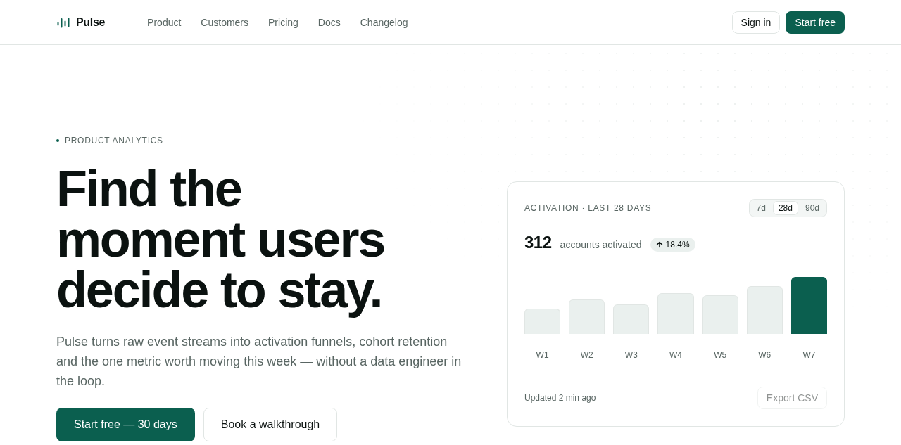
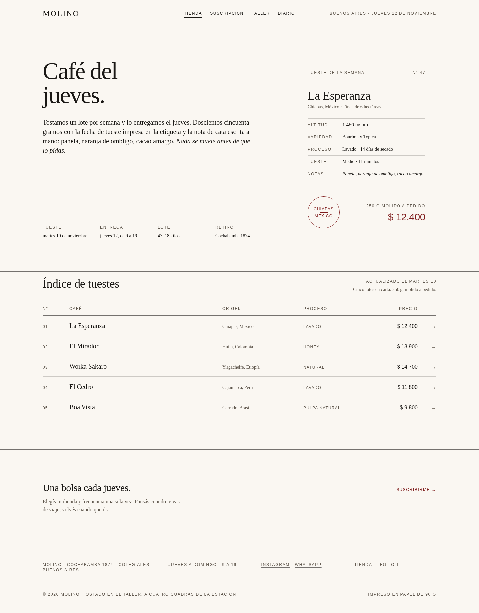

# gentle-design-skill

Professional-grade design quality for the [gentle-design](https://gentlemanprogramming.com/gentle-shell/) workflow — a companion skill that makes artboards look like they came from **Vercel v0, Google Stitch, or a senior product designer**, instead of the statistical median of AI output ("AI slop" / vibe-coding look).

Built by **reverse engineering** (REA methodology) how professional AI design tools actually work: runtime captures, official engineering blogs, published harness internals, and public anti-slop skills. Every rule in the skill cites its evidence.



## What it encodes

| Layer | File | Source of the rules |
| --- | --- | --- |
| Evidence log | `references/evidence.md` | shadcn/ui runtime captures, v0/Stitch official docs, Tailwind v4, Radix, Anthropic/Vercel/Lovable engineering posts |
| Token system | `references/token-system.md` | shadcn semantic roles, Tailwind 4px ramp + type scale, Radix 12-step accent ramps |
| Anti-generic playbook | `references/generic-vs-professional.md` | published anti-slop skills (substitution test, visual thesis, named alternatives, mechanical tells) |
| Art-direction catalog | `references/style-directions.md` | 8 named directions (Swiss, Editorial, Brutalist, Terminal, Soft SaaS, Luxury, Playful, Dark Glass) + Direction Contract |
| Platform rules | `references/platform-web.md` · `-mobile.md` · `-desktop.md` | web/marketing/dashboard, iOS+Material mobile, desktop-class density/keyboard |
| Dark mode | `references/dark-mode.md` | 11-role re-mapping, lightness-ladder elevation, Linear's LCH model |
| Harness architecture | `references/harness-architecture.md` | how Stitch, design.md, v0, Anthropic skills, Lovable work internally |
| Pre-delivery checklist | `references/professional-pass.md` | ~40 mechanical checks + render→screenshot→critique loop |
| **Deterministic gate** | `scripts/design-gate.py` | 12 static rules (tokens, 4px ramp, `transition: all`, tells) — exits 0/1, `--json` mode |

## How it works in a session

1. **Direction Contract first** (taste before tokens): pick a style direction, freeze THESIS / palette budget / forbidden moves.
2. **Foundation Pass**: semantic token block in `:root` — 3–5 colors, one radius token, 4px ramp, documented type scale.
3. **Craft Pass**: hierarchy by weight/size, color discipline (~90% neutral surfaces), texture over decoration, full state matrix, motion under 300ms.
4. **Professional Gate**: run the gate script, then render → screenshot → critique → fix.
5. Approved designs emit a `DESIGN.md` (Google spec, YAML tokens + rationale), kept lint-clean with `npx -y @google/design.md lint`.

## Install

Copy the skill into your agent's skill directory (Gentle Shell / Pi reads `~/.agents/skills/`):

```bash
git clone https://github.com/Reaan06/gentle-design-skill
cp -r gentle-design-skill/skill/gentle-design-skill ~/.agents/skills/
```

Requires: [gentle-shell](https://github.com/Gentleman-Programming/gentle-shell) (or any Pi runtime) with the `gentle-design` + `gentle-ui-design` skills; Python 3 stdlib for the gate; optional `npx @google/design.md` for DESIGN.md linting.

## Proof

- **Pulse** (analytics SaaS): web landing 1440×900, mobile 390×844, desktop workspace 1440×900 + dark variants — 86/86 structural checks, gate clean, DESIGN.md lint clean. `examples/pulse-analytics/`
- **Molino** (coffee roastery, Editorial direction): authored from a frozen Direction Contract — storefront with a printed roast-label plate and folio index (no card grid), subscription with designed states; accent budget spent exactly 3 times per view; the substitution test fails as required (it could only belong to a roaster). `examples/molino-cafe/`



## Gentle Hub

This repository carries the `gentle-shell-package` + `gentle-shell-skill` topics so the [Gentle Hub](https://gentlemanprogramming.com/gentle-hub/) community catalog can discover it.

Listing is not an endorsement; quality claims are backed by the evidence log and the runnable gate, not by stars.

## License

MIT — see [LICENSE](LICENSE).
